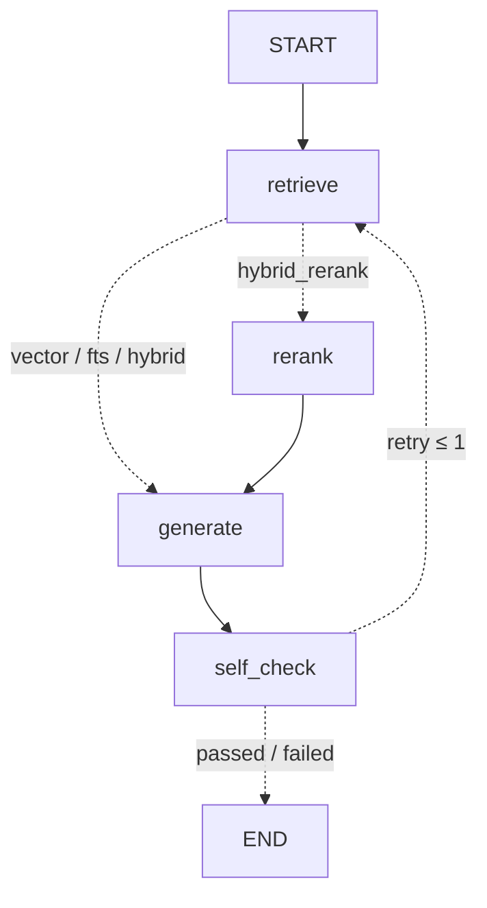

# RAG по литературе диссертации

Поиск и ответы с цитатами по личной научной библиотеке (гидроэнергетика, водные ресурсы, прогноз стока,
стохастическая оптимизация): 191 PDF на русском и английском (статьи, книги, диссертации, нормативные документы;
в индексе 177 с текстовым слоем, 14 сканов без OCR не проиндексированы) и 225 аналитических заметок из Zotero.
Всё работает локально: PostgreSQL + pgvector, эмбеддинги на CPU, reranker на GPU (или CPU), генерация через Ollama.
Облачные API не используются.

> Pet-проект. Корпус (PDF, заметки, BibTeX) в репозиторий не входит — только код, eval-набор и агрегированные метрики.

## Схема

```
PDF (pymupdf, номера страниц) ─┐
заметки .md (якорь = заголовок)┴─> чистка -> чанки ~400 токенов, перекрытие 15 %, по границам абзацев/предложений
                                     -> e5 "passage: " эмбеддинги (CPU)
                                     -> PostgreSQL 16: chunks(embedding vector(768) + HNSW, tsv tsvector + GIN)

вопрос -> LangGraph:
   retrieve (вектор top-50 + полнотекстовый top-50 -> RRF)
            полнотекстовая ветка: слова вопроса + английские термины от qwen2.5:7b (~2,6 с),
            иначе русский вопрос не имеет общих слов с английской статьёй
     -> rerank (bge-reranker-v2-m3, top-20 -> top-6)      [опционально, --mode hybrid отключает]
     -> generate (Ollama qwen2.5:7b, JSON: ответ + 3–5 дословных цитат с номером фрагмента)
     -> self_check (каждая цитата сверяется с фрагментом; < 3 подтверждённых -> переформулировать запрос,
                    повторить поиск, не более 1 раза; лучше из двух попыток)
   -> ответ + цитаты: ключ Zotero | файл | страница (или раздел заметки)
```



## Стек

| Компонент | Выбор | Почему |
|---|---|---|
| Хранилище | PostgreSQL 16 + pgvector 0.8 (Docker `pgvector/pgvector:pg16`) | векторы и полнотекстовый поиск в одной базе, один SQL-запрос на тип поиска |
| Полнотекстовый поиск | `tsvector` с конфигурацией `russian`, GIN | в PostgreSQL конфигурация `russian` стеммит кириллицу `russian_stem`, а латиницу — `english_stem`: одна колонка покрывает смешанный RU/EN корпус |
| Эмбеддинги | `intfloat/multilingual-e5-base` (768, CPU, sentence-transformers) | многоязычная, вопрос на русском находит английскую статью; префиксы `query:`/`passage:` |
| Reranker | `BAAI/bge-reranker-v2-m3` (cross-encoder, fp16 на RTX 2080; CPU — запасной вариант) | многоязычный; на GPU ~0,4 с на 20 кандидатов против ~35 с на CPU |
| Генерация | Ollama `qwen2.5:7b` + structured output (JSON schema) | локально, без платных API; JSON-схема заставляет вернуть 3–5 цитат |
| Перевод запроса для FTS | та же `qwen2.5:7b`, temperature 0 | английские термины русского вопроса только для полнотекстовой ветки (`FTS_TRANSLATE=0` — выключить) |
| Оркестрация | LangGraph `StateGraph` | условные рёбра (rerank опционален), цикл self_check -> retrieve |
| Парсинг | pymupdf (блоки = абзацы, номер страницы), заметки — markdown как есть | |

## Запуск

```bash
# 1. База (порт 5433: на 5432 может стоять локальный PostgreSQL)
cp .env.example .env            # задать свой PGPASSWORD
docker run -d --name rag-pgvector -e POSTGRES_USER=rag -e POSTGRES_PASSWORD=<пароль из .env> \
  -e POSTGRES_DB=rag -p 5433:5432 -v rag_pgdata:/var/lib/postgresql/data pgvector/pgvector:pg16

# 2. Окружение (Python 3.11)
python -m venv .venv && .venv/Scripts/activate
pip install torch --index-url https://download.pytorch.org/whl/cu130   # GPU для reranker'а; без GPU: .../whl/cpu
pip install -r requirements.txt

# 3. LLM
ollama pull qwen2.5:7b

# 4. Индексация (один раз; повторный запуск доиндексирует только новое)
python -m rag index --reset

# 5. Поиск фрагментов
python -m rag query "вопрос" --mode hybrid -k 5        # vector | fts | hybrid | hybrid_rerank
# 6. Ответ с цитатами (граф LangGraph)
python -m rag ask "вопрос"                              # по умолчанию hybrid_rerank
python -m rag ask "вопрос" --mode hybrid                # без reranker'а, быстрее на CPU
# 7. Eval: 4 конфигурации, поиск + генерация, таблица метрик
python -m rag eval
python -m rag eval --no-generate --scope pdf            # только поиск, только полные тексты (основной прогон)
python -m rag eval --no-generate --scope pdf --split dev # настройка — только на dev-части
python -m rag eval --scope pdf --fts-translate 0         # без перевода запроса (базовый гибрид)
```

Пути к корпусу задаются в `.env` (`CORPUS_DIR`, `BIB_PATH`); ожидается структура «Базы знаний»:
`PDFs/<ключ Zotero>.pdf`, `Individual_Notes/<ключ>_note.md`, `export_manifest.json` (привязка к главам).

## Результаты

Eval-набор — `evals/questions.yaml`, **40 вопросов** на русском. У каждого есть правильный источник (ключ Zotero):
- 28 вопросов составлены по аналитическим заметкам,
- 12 — по аннотациям PDF: источники выбраны случайно, 6 русскоязычных и 6 англоязычных PDF.

Набор разбит на **dev (21) и test (19)** до любых изменений ранжирования. Разбиение фиксированное, стратифицировано по группам. Все варианты настраивались только на dev. Test прогнан один раз, в финальной серии 23.09.2026.

Изначально вопросов было 42. Два вопроса касались внутренних документов, которые нельзя публиковать, поэтому их убрали из публичной версии набора. Сохранённые прогоны пересчитаны без них, ответы и ранги не менялись.

**Основной прогон — только по полным текстам PDF** (`--scope pdf`, 177 PDF, 11 656 чанков). Вопросы по заметкам составлены по заметкам, которые лежат в том же индексе. Поэтому при поиске по PDF и заметкам прогон почти насыщен (recall 0,93–1,00) и конфигурации там плохо различаются (см. ниже).

### Поиск: четыре конфигурации (scope=pdf, 40 вопросов, 23.09.2026)

Гибрид — это RRF по векторному и полнотекстовому спискам (k=60, равные веса). В FTS-ветку добавлены английские термины запроса. Reranker получает 20 кандидатов гибрида, на GPU.

| конфигурация | recall@5 | recall@10 | MRR@10 | MRR dev (21) | MRR test (19) | поиск p50 | поиск p95 |
|---|---|---|---|---|---|---|---|
| vector | 0.68 | 0.72 | 0.527 | 0.497 | 0.559 | 0.2 с | 0.3 с |
| fts (BM25 + перевод терминов) | 0.90 | 0.95 | 0.831 | 0.762 | 0.907 | 3.2 с | 3.8 с |
| hybrid (RRF) | 0.85 | 0.97 | 0.672 | 0.635 | 0.713 | 3.6 с | 4.7 с |
| hybrid + reranker | **0.97** | **1.00** | **0.917** | 0.922 | 0.912 | 4.4 с | 6.8 с |

Около 2,6 с латентности FTS и гибрида уходит на перевод терминов через `qwen2.5:7b` на GPU.

Файл прогона: `evals/results/eval_2026-09-23_0857_pdf_final_retrieval_translate.md`. Recall считается по чанкам: засчитывается попадание, если среди top-k есть чанк ожидаемого источника.

**По группам вопросов.** «same» — язык вопроса совпадает с языком источника, «cross» — русский вопрос к английской статье.

| конфигурация | same (17): R@10 / MRR | cross (23): R@10 / MRR |
|---|---|---|
| vector | 1.00 / 0.814 | 0.52 / 0.315 |
| fts без перевода | 0.88 / 0.824 | 0.13 / 0.109 |
| hybrid без перевода | 1.00 / 0.836 | 0.39 / 0.214 |
| fts с переводом | 0.94 / 0.868 | 0.96 / 0.804 |
| hybrid с переводом | 1.00 / 0.860 | 0.96 / 0.533 |
| hybrid + reranker | 1.00 / 0.961 | 1.00 / 0.885 |

### Почему гибрид сначала был хуже вектора и что изменилось

До переделки гибрид по одним PDF проигрывал вектору: MRR 0,478 против 0,527 (`evals/results/eval_2026-09-23_0906_pdf_final_retrieval_baseline.md`). Разбивка по группам показала причину:
- **В 23 вопросах из 40 русский вопрос задан к английской статье.** Общих слов с текстом нет, и BM25 находит правильный источник лишь в 3 из 23 случаев.
- Вместо этого BM25 уверенно возвращает русские PDF по общим словам. В RRF этот шум вытесняет правильные векторные попадания.
- На вопросах, где язык совпадает, гибрид и без перевода был лучше вектора: MRR 0,836 против 0,814.

Три варианта, проверенных на dev (21 вопрос, файлы `eval_2026-09-23_08*_pdf_dev_*.md`):

| вариант | hybrid dev MRR | hybrid dev R@10 |
|---|---|---|
| v0: как было | 0.464 | 0.62 |
| v1: вес FTS в RRF 0.5 | 0.472 | 0.62 |
| v2: + английские термины от LLM в FTS | 0.636 | 0.90 |
| v3: v2 с исправленным промптом (выбран) | **0.660** | **0.95** |

Пояснения к вариантам:
- **Словарь `russian` + `english` (вариант «а» из плана) не проверялся как отдельный.** Конфигурация `russian` в PostgreSQL уже стеммит латиницу `english_stem`, это проверено: `to_tsvector('russian', 'reservoirs operation')` → `reservoir`, `oper`. Проблема не в словаре, а в том, что в запросе нет английских слов.
- **v2 → v3.** Первый промпт перечислял области знаний, и модель вставляла этот список («hydrology hydropower reservoirs optimization machine learning») в термины каждого запроса. После исправления промпта это ушло.

**Итог по критерию «гибрид лучше вектора».** На test MRR 0,713 против 0,559, recall@10 1,00 против 0,74. Критерий выполнен, но с оговорками:
- **Выигрыш даёт в основном переведённая FTS-ветка.** Сам FTS с переводом по MRR выше гибрида: 0,831 против 0,672. На кросс-языковых вопросах мешает вектор: e5-base слабо сопоставляет русский вопрос с английским текстом. Recall@10 у гибрида выше (0,97 против 0,95), а reranker поверх гибрида даёт лучший результат по всем метрикам.
- **12 вопросов по аннотациям PDF писал тот же человек, что и код.** Поэтому они лексически ближе к тексту и выгодны FTS: FTS находит все 12. На 28 вопросах по заметкам картина та же, но разрыв меньше: MRR hybrid 0,615, vector 0,449, fts 0,758.

### PDF + заметки (с утечкой, для сравнения)

scope=all, 40 вопросов: vector 0.93 / 0.93 / 0.800, fts 1.00 / 1.00 / 0.956, hybrid 0.97 / 0.97 / 0.883, hybrid + reranker 1.00 / 1.00 / 0.988 (R@5 / R@10 / MRR). Заметка, по которой составлен вопрос, находится почти всегда.

### Reranker: CPU и GPU

Один и тот же `bge-reranker-v2-m3`, 8 вопросов:

| устройство, кандидатов | время reranker'а на запрос (медиана) | ранги |
|---|---|---|
| CPU, 20 | ~34 с | — |
| CPU, 10 | ~16 с | один вопрос выпал из top-10 |
| GPU RTX 2080 fp16, 20 | ~0,5 с (1,5 с вместе с поиском) | как на CPU/20 |

Итог: в проекте reranker работает на GPU с 20 кандидатами. Ollama и reranker помещаются в 8 ГБ вместе: занято ~6,5 ГБ.

### Ответы с цитатами: eval с генерацией (scope=pdf, 40 вопросов, 23.09.2026)

Прогон по всему графу: retrieve → [rerank] → generate (`qwen2.5:7b`, 6 фрагментов в контексте) → self_check, не больше 1 повтора. Каждая конфигурация запускалась отдельным процессом, файлы `evals/results/eval_2026-09-23_*_pdf_final_full_<конфигурация>.md`.

| конфигурация | citation_precision | ответов с ≥ 3 подтверждёнными цитатами | ответ цитирует нужный источник | повтор self_check | ответ p50 | ответ p95 |
|---|---|---|---|---|---|---|
| vector | 0.88 | 0.83 | 0.58 | 0.33 | 15.8 с | 35.1 с |
| fts | 0.92 | 0.80 | 0.88 | 0.43 | 20.4 с | 41.4 с |
| hybrid | 0.88 | 0.78 | 0.83 | 0.53 | 28.8 с | 59.2 с |
| hybrid + reranker | **0.95** | **0.88** | **0.93** | 0.45 | 24.9 с | 46.3 с |

Как читать столбцы:
- **citation_precision** — доля цитат, которые дословно (≥ 90 % токенов подряд) найдены в указанном фрагменте.
- **«Ответ цитирует нужный источник»** — среди подтверждённых цитат есть ожидаемый ключ Zotero.
- **Латентность ответа** — полное время графа: перевод терминов, поиск, reranker, генерация и повтор, если он был.

Стоимость 0: всё локально.

Замечания:
- **Критерий «3–5 цитат с источником».** В конфигурации по умолчанию (hybrid + reranker) он выполнен в 88 % ответов, в среднем 3,1 цитаты на ответ. В остальных ответах после повтора осталось меньше 3 подтверждённых цитат. Такие ответы помечаются `self_check: failed`, неподтверждённые цитаты отбрасываются.
- **Зацикливание генерации.** Во время прогона генерация по JSON-схеме один раз ушла в бесконечный вывод, и запрос отвалился по таймауту через 10 мин. После этого добавлен лимит `num_predict=1500`: нормальный ответ занимает до ~950 токенов. Сбой отдельного вопроса теперь не обрывает eval. Прогон vector сделан до этого исправления, но ни один его ответ не приблизился к лимиту, поэтому на результат это не влияет.
- **Перевод терминов не полностью детерминирован** между запусками Ollama, хотя стоит temperature 0 и фиксированный seed. MRR гибрида в этом прогоне 0,688, в прогоне только поиска — 0,672.
- **`must_contain`** есть только у 5 вопросов, и проверка грубая: подстрока в ответе. Поэтому в сравнении эта метрика не используется.

## MCP и трейсинг (добавлено 18.10.2026)

Пробный шаг: поиск и граф доступны агенту как MCP-инструменты, трейсы — в локальном Arize Phoenix. Сделано за вечер на этом pet-проекте; в продакшене не использовалось.

**MCP-сервер** — `rag/mcp_server.py`, официальный Python SDK `mcp` 2.x (`MCPServer`, бывший FastMCP), транспорт stdio. Два инструмента, оба read-only:
- `search(query, mode="hybrid_rerank", k=6, pdf_only=True)` → фрагменты: ключ Zotero, файл, страница, score, начало текста (до 600 символов), время по этапам;
- `ask(question, mode="hybrid_rerank", pdf_only=True)` → ответ графа, только подтверждённые цитаты, число отброшенных, `self_check`, источники контекста, время.

Ответы структурированные (pydantic → `outputSchema` и `structuredContent`). В описаниях инструментов сказано, когда какой режим брать: `fts` с переводом сильнее на кросс-языковых вопросах, reranker лучше по качеству, но дороже по времени.

```bash
# .mcp.json (project scope), путь к .venv относительный и в стиле Windows: Claude Code нужно открыть
# в папке rag_dissertation и подтвердить сервер; из корня другого проекта он не подхватится
.venv/Scripts/python.exe scripts/mcp_smoke.py              # smoke-тест через клиент SDK: list_tools, search, ask
.venv/Scripts/python.exe scripts/mcp_smoke.py --eval 5 7   # вопросы из evals/questions.yaml
```

**Трейсинг** — `rag/tracing.py`, включается `RAG_TRACE=1`. Без флага провайдер OpenTelemetry не создаётся и ничего не экспортируется, поведение и eval прежние.
- Узлы LangGraph — инструментирование OpenInference для LangChain.
- Ollama вызывается через `requests`, поэтому спаны LLM поставлены вручную в `llm.chat`: модель, токены, разбивка времени со стороны Ollama.
- MCP SDK 2.x сам добавляет спан `tools/call <инструмент>`.
- Экспорт — OTLP/HTTP только на локальный адрес. Нелокальный `RAG_TRACE_ENDPOINT` отклоняется: в трейсах текст фрагментов корпуса.

```bash
PHOENIX_HOST=127.0.0.1 PHOENIX_TELEMETRY_ENABLED=false .venv/Scripts/phoenix serve   # UI: http://127.0.0.1:6006
RAG_TRACE=1 .venv/Scripts/python.exe -m rag ask "вопрос" --pdf-only
.venv/Scripts/python.exe scripts/trace_summary.py --last 2    # длительности спанов из Phoenix, без текста
```

**Что видно в трейсе.** Один прогретый `ask` через MCP (вопрос 7 из eval, hybrid_rerank, 18.10.2026):

| спан | время | из чего состоит |
|---|---|---|
| `tools/call ask` → `LangGraph` | 13,0 с | |
| `retrieve` | 3,0 с | перевод терминов (`ollama.chat`) 2,6 с, на сервере Ollama из них 0,5 с; эмбеддинг и SQL ~0,5 с |
| `rerank` | 0,3 с | bge-reranker на GPU, 20 кандидатов |
| `generate` | 9,3 с | `ollama.chat_json`: 2733 токена на входе, 367 на выходе; декодирование 7,2 с, prefill 0,05 с |
| `self_check` | < 0,01 с | повтора не было |

Выводы из одного трейса:
- **Основное время — декодирование ответа**: ~50 токенов/с у qwen2.5:7b на RTX 2080.
- **Около 2 с на каждом вызове Ollama — не модель.** Это разница между длительностью спана и `total_duration` от Ollama. На Windows `http://localhost:11434` сначала пробует IPv6 и теряет ~2,05 с на запрос, `http://127.0.0.1:11434` отвечает за 3 мс. На вызов `ask` это ~4 с из 13. Отсюда же ~2 из «~2,6 с на перевод» в таблицах выше.
- С `OLLAMA_URL=http://127.0.0.1:11434` тот же `ask` занял 13,6 с против 16,6 с с `localhost`, `retrieve` — 1,1 с против 3,0 с. Это по одному прогону, в обоих reranker грузился с нуля. Адрес по умолчанию не менялся, чтобы не расходиться с сохранёнными замерами.
- **Холодный старт**: первый вызов после запуска сервера — 17 с на `retrieve` (загрузка e5) и 5 с на `rerank` (загрузка reranker'а).

Ограничения:
- Проверено одним smoke-тестом и тремя вопросами (1 короткий + вопросы 5 и 7 из eval), не на всём наборе. На вопросе 5 ожидаемый источник не попал в top-6 — как и в сохранённом eval (ранг 9 у hybrid_rerank, 4 у fts).
- Подключение в Claude Code проверено только тем же способом запуска (команда и аргументы из `.mcp.json`) через Python-клиент SDK; в самом Claude Code — нет.
- Модели e5 и reranker при загрузке проверяют обновления на Hugging Face (`HF_HUB_OFFLINE=1` — отключить); данные корпуса туда не уходят.

## Ограничения

- **14 PDF — сканы без текстового слоя**, в основном нормативные документы и старые книги. Их нет в индексе, OCR не делался.
- **Чанки ~400 токенов вместо 600–800 из ТЗ.** multilingual-e5-base обрезает вход на 512 токенах. При 700–800 токенах обрезались бы 96 % чанков (6 593 из 6 848, `evals/results/index_stats_dry_700.json`). Другие размеры (например, 200) на eval не сравнивались.
- **Формулы и таблицы.** Блоки, где букв меньше 50 %, выбрасываются: это 13 % блоков PDF. Формулы и числовые таблицы в поиск не попадают, вопросы «по формуле» не работают. Колонтитулы (32 % блоков) убираются эвристикой повторяемости и могут изредка задеть настоящий текст.
- **Утечка вопросов из заметок в индекс.** 28 из 40 вопросов составлены по заметкам, которые проиндексированы вместе с PDF. Поэтому основной прогон идёт по одним PDF, а прогон с заметками приведён только для сравнения.
- **Маленький eval-набор.** 40 вопросов, 21 в dev и 19 в test, в группах 12–23 вопроса. Один вопрос меняет recall на 2,5–8 п. п., и различия в несколько сотых MRR незначимы.
- **Разметка неполная.** У каждого вопроса 1–2 «правильных» источника, но в корпусе бывают другие релевантные работы. Например, диссертация соавтора на ту же тему (вопрос 2) или работа 2021 г. того же автора (вопрос 7). Их попадание считается промахом, то есть метрики занижены.
- **Статистика BM25 (IDF) считается по всему корпусу**, включая заметки, и в scope=pdf тоже.
- **Reranker на CPU медленный**: ~34 с на запрос при 20 кандидатах. Приемлемо только на GPU.
- **Память.** Ollama (llama-server дорос до ~14 ГБ выделенной памяти) вместе с процессом eval (reranker + эмбеддинги) на машине с 32 ГБ однажды упёрлись в лимит файла подкачки (os error 1455). Помог перезапуск Ollama. Ответ целиком занимает ~25 с по медиане — это инструмент для исследователя, не для интерактивного чата.
- **Локальная модель 7B.** Качество ответа и перевода терминов ограничено `qwen2.5:7b`: 12 % ответов остаются без 3 подтверждённых цитат, изредка случается зацикливание генерации (обрезается `num_predict`). Перевод добавляет ~2,6 с к каждому запросу и нужен работающий Ollama даже для `rag query`.
- **Корпус не публикуется.** В репозитории только код, вопросы eval и агрегированные метрики. Сырые ответы (`evals/results/*.jsonl`) содержат цитаты из корпуса и в репозиторий не попадают.
